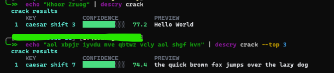
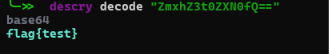
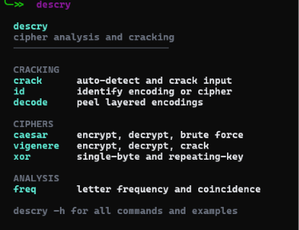

<div align="center">

# descry

Identify, decode, and crack classical ciphers from the command line.

    

[What it does](#what-it-does) | [Demo](#demo) | [Install](#install) | [Quick start](#quick-start) | [Commands](#commands) | [How it works](#how-it-works) | [Limitations](#limitations) | [Testing](#testing) | [Contributing](#contributing) | [License](#license)

</div>

## What it does

descry handles the first pass of a CTF cipher challenge: it identifies encodings, removes layered transformations, and ranks Caesar, Vigenere, and XOR candidates by how much the output looks like English. It reads from an argument, a file, or standard input, and it prints plain text when piped so the output composes with other shell tools. Every candidate from every command is scored with the same English model, which keeps rankings comparable across commands. It does not attack modern cryptography, and it does not guess languages other than English.

## Demo

<div align="center">
  
</div>

```console
$ descry crack "S2hvb3IgWnJ1b2c="
1  base64 -> caesar shift 3   77.2  Hello World
2  base64                     31.2  Khoor Zruog
```

<details>
<summary>Decode session screenshot</summary>

<div align="center">
  
</div>

</details>

## Install

Requires Python 3.9 or newer. The preferred method on every platform is pipx, which installs the tool in its own environment:

```console
pipx install git+https://github.com/zer0k7/descry.git
```

If you install from a fork, replace `zer0k7` in the URL with the owner name.

<details>
<summary>Windows (PowerShell)</summary>

Check the Python version:

```powershell
py --version
```

Install pipx and add its binary directory to PATH:

```powershell
py -m pip install --user pipx
py -m pipx ensurepath
```

Close and reopen the terminal, then install descry:

```powershell
pipx install git+https://github.com/zer0k7/descry.git
```

A pip install also works:

```powershell
py -m pip install --user git+https://github.com/zer0k7/descry.git
```

Verify the command:

```powershell
descry -h
```

If `descry` is not found, run `py -m site --user-base` and add `Scripts` to that path in the user environment variables. A common location is `%APPDATA%\Python\Python312\Scripts`.

Update:

```powershell
pipx reinstall descry
```

```powershell
py -m pip install --user --upgrade git+https://github.com/zer0k7/descry.git
```

Uninstall:

```powershell
pipx uninstall descry
```

```powershell
py -m pip uninstall descry
```

</details>

<details>
<summary>macOS (Terminal)</summary>

Check the Python version:

```console
python3 --version
```

Install pipx with Homebrew and add its binary directory to PATH:

```console
brew install pipx
pipx ensurepath
```

Close and reopen the terminal, then install descry:

```console
pipx install git+https://github.com/zer0k7/descry.git
```

A user level pip install also works:

```console
python3 -m pip install --user git+https://github.com/zer0k7/descry.git
```

Verify the command:

```console
descry -h
```

`pipx ensurepath` adds `~/.local/bin` to the shell path. For a `--user` pip install, add the user base `bin` directory to `~/.zshrc`, for example:

```console
export PATH="$HOME/Library/Python/3.12/bin:$PATH"
```

Update:

```console
pipx reinstall descry
```

```console
python3 -m pip install --user --upgrade git+https://github.com/zer0k7/descry.git
```

Uninstall:

```console
pipx uninstall descry
```

```console
python3 -m pip uninstall descry
```

</details>

<details>
<summary>Linux (Debian, Ubuntu, Fedora, Arch)</summary>

Check the Python version:

```console
python3 --version
```

Install pipx with the package manager for your distribution:

```console
sudo apt update && sudo apt install pipx
```

```console
sudo dnf install pipx
```

```console
sudo pacman -S python-pipx
```

Add the pipx binary directory to PATH:

```console
pipx ensurepath
```

Close and reopen the shell, then install descry:

```console
pipx install git+https://github.com/zer0k7/descry.git
```

Recent Debian, Ubuntu, and Fedora releases mark the system Python as externally managed and reject pip installs outside a virtual environment. Use pipx, or create a virtual environment before calling pip. If you choose pip directly:

```console
python3 -m pip install --user git+https://github.com/zer0k7/descry.git
```

Verify the command:

```console
descry -h
```

`pipx ensurepath` adds `~/.local/bin`. If that directory is missing from PATH, add this line to `~/.bashrc` or `~/.zshrc`:

```console
export PATH="$HOME/.local/bin:$PATH"
```

Update:

```console
pipx reinstall descry
```

```console
python3 -m pip install --user --upgrade git+https://github.com/zer0k7/descry.git
```

Uninstall:

```console
pipx uninstall descry
```

```console
python3 -m pip uninstall descry
```

</details>

### Install from source

```console
git clone https://github.com/zer0k7/descry.git
cd descry
python -m pip install .
```

On Windows, use `py -m pip install .` for the last command.

### Development install

```console
git clone https://github.com/zer0k7/descry.git
cd descry
python -m pip install -e .
```

### Troubleshooting

* `descry: command not found`: open a new terminal after `pipx ensurepath`, then check that `~/.local/bin` or the Python `Scripts` directory is on PATH.
* PATH not updated: run `pipx ensurepath` again, restart the shell, and confirm the entry with `pipx list`.
* Wrong Python version: check `py --version` or `python3 --version`. Install Python 3.9 or newer, then point pipx at the right interpreter with `pipx install --python python3.12 git+https://github.com/zer0k7/descry.git`.
* `externally-managed-environment`: use pipx or a virtual environment instead of the system pip.

## Quick start

```console
$ descry caesar enc "Hello World" --shift 3
Khoor Zruog

$ descry caesar dec "Khoor Zruog" --shift 3
Hello World

$ echo "Khoor Zruog" | descry crack
1  caesar shift 3   77.2  Hello World

$ descry id "S2hvb3IgWnJ1b2c="
1  base64   92.0  Khoor Zruog

$ descry decode "NzU3Mjc5Nzk2MjIwNmE2MjY1Nzk3MQ=="
hello world

$ descry xor crack "162a2762312721302736622f273131232527622b31622a2b2626272c622a2730276c" --top 1
1  0x42   78.6  The secret message is hidden here.
```

## Commands

| Command | Purpose | Example |
| --- | --- | --- |
| `crack` | Try every supported cipher and encoding, then rank the candidates. | `descry crack "S2hvb3IgWnJ1b2c="` |
| `id` | Identify the most likely encoding or cipher. | `descry id "S2hvb3IgWnJ1b2c="` |
| `decode` | Remove layered encodings until the text is readable. | `descry decode "NzU3Mjc5Nzk2MjIwNmE2MjY1Nzk3MQ=="` |
| `caesar enc` | Shift letters forward by a fixed amount. | `descry caesar enc "Hello World" --shift 3` |
| `caesar dec` | Reverse a known Caesar shift. | `descry caesar dec "Khoor Zruog" --shift 3` |
| `caesar brute` | Try all 26 shifts and rank them. | `descry caesar brute "Khoor Zruog" --top 3` |
| `vigenere enc` | Encrypt with a repeating letter key. | `descry vigenere enc "Attack at dawn" --key LEMON` |
| `vigenere dec` | Decrypt with a known key. | `descry vigenere dec "Lxfopv ef rnhr" --key LEMON` |
| `vigenere crack` | Recover the key and plaintext from ciphertext. | `descry vigenere crack -f cipher.txt --top 3` |
| `xor enc` | Encrypt bytes with a text or hex key. | `descry xor enc "secret" --key key` |
| `xor dec` | Decrypt hex or raw bytes. | `descry xor dec "18001a19000d" --key key` |
| `xor crack` | Recover single-byte or repeating-key XOR. | `descry xor crack -f cipher.txt --top 3` |
| `freq` | Print letter counts and coincidence statistics. | `descry freq "The quick brown fox jumps over the lazy dog"` |

<details>
<summary>crack examples</summary>

```console
descry crack "Khoor Zruog"
descry crack "S2hvb3IgWnJ1b2c=" --top 2
echo "01001000 01101001" | descry crack
```

</details>

<details>
<summary>id examples</summary>

```console
descry id "Khoor Zruog"
descry id "01001000 01101001"
descry id ".... . .-.. .-.. --- / .-- --- .-. .-.. -.."
```

</details>

<details>
<summary>decode examples</summary>

```console
descry decode "ZmxhZ3t0ZXN0fQ=="
descry decode "S2hvb3IgWnJ1b2c="
descry decode "%48%65%6c%6c%6f%20%57%6f%72%6c%64"
```

</details>

<details>
<summary>caesar enc examples</summary>

```console
echo "Attack at dawn" | descry caesar enc --shift 7
descry caesar enc "Hello, World! 123" --shift 13
```

</details>

<details>
<summary>caesar dec examples</summary>

```console
descry caesar dec "Uryyb, Jbeyq! 123" --shift 13
descry caesar dec "Khoor Zruog" --shift 3 --format json
```

</details>

<details>
<summary>caesar brute examples</summary>

```console
echo "Wklv vhfuhw" | descry caesar brute --top 5
descry caesar brute "Khoor Zruog"
```

</details>

<details>
<summary>vigenere enc examples</summary>

```console
echo "Meet me at noon" | descry vigenere enc --key KEY
descry vigenere enc "Attack at dawn" --key LEMON --format json
```

</details>

<details>
<summary>vigenere dec examples</summary>

```console
descry vigenere dec "Wicd qc kx lysl" --key KEY
descry vigenere dec -f cipher.txt --key LEMON
```

</details>

<details>
<summary>vigenere crack examples</summary>

```console
descry vigenere crack -f cipher.txt --max-key-length 12
descry vigenere crack -f cipher.txt --top 3
```

</details>

<details>
<summary>xor enc examples</summary>

```console
descry xor enc "secret" --key key
descry xor enc "secret" --key 2a --hex-key
```

</details>

<details>
<summary>xor dec examples</summary>

```console
descry xor dec "18001a19000d" --key key
descry xor dec "1b1e1d1e1f" --key key
descry xor dec "18001a19000d" --key key --hex-output
```

</details>

<details>
<summary>xor crack examples</summary>

```console
descry xor crack "162a2762312721302736622f273131232527622b31622a2b2626272c622a2730276c" --top 1
descry xor crack "162a2762312721302736622f273131232527622b31622a2b2626272c622a2730276c" --single
descry xor crack "1f2d3c6b363c28373c3f65342e362a2a223c6b2c2a6b2d302f213c2565312e373c65650d23207938203a39202d6b283c3836382c2079223679232c3d2f20376b2d3c392077" --top 3
```

</details>

<details>
<summary>freq examples</summary>

```console
descry freq "Hello"
descry freq -f cipher.txt --format json
```

</details>

<details>
<summary>Command overview screenshot</summary>

<div align="center">
  
</div>

</details>

## How it works

Every candidate is scored with the same English model. The model runs chi-squared against standard English letter frequencies, then adds bonuses for common words, bigrams, and trigrams, with printable text and letter density checks to reject binary output. Confidence maps the raw score to a 0 to 100 range with `100 * sqrt(raw / 100)`, so near ties stay close and clearly readable text lands in the 70 to 90 range.

Caesar cracking applies the model to all 26 shifts. Vigenere cracking uses index of coincidence across key length columns and Kasiski repeated sequences to propose key lengths, recovers each column as a Caesar shift, and keeps the key with the best plaintext score. XOR cracking tries all 256 single-byte keys, and for repeating keys it ranks lengths by normalized Hamming distance before recovering each column. The decode command runs a breadth first search over base64, base32, hex, binary, URL, Morse, and ROT13 decoders and keeps the path with the highest score.

<details>
<summary>Score components</summary>

| Signal | Role |
| --- | --- |
| Chi-squared | Distance from standard English letter frequencies. |
| Index of coincidence | Detects repeated key structure. |
| Word, bigram, and trigram matches | Reward likely English sequences. |
| Printable ratio and letter density | Reject binary and symbol noise. |

</details>

## Limitations

* English text only. Other languages score poorly.
* Vigenere and repeating-key XOR need a few hundred letters to recover a key reliably.
* Classical ciphers only. The tool is not built for modern cryptography.
* Encoding detection can flag plausible but wrong transformations on arbitrary strings.
* Confidence is a heuristic, not a proof. Read the top result before trusting it.

## Testing

```console
python -m unittest discover -s tests -v
```

The suite covers cipher round trips, cracker samples, scoring order, decoding layers, and CLI exit codes.

## Contributing

Open an issue for bugs or missing cipher support. Pull requests should keep the standard library only rule and include tests for new behavior. Run the test suite and `python -m pyflakes descry tests` before submitting. Keep each change focused.

## License

Released under the [MIT License](LICENSE).

<div align="center">
<sub>zer0k7</sub>
</div>
